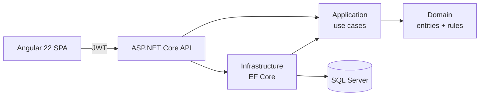

# ClinicHub

A **multi-tenant clinic management SaaS**: patients, doctors and appointment booking. It's built with **.NET 10, ASP.NET Core, EF Core, SQL Server and Angular 22**.

Many clinics share one deployment and one database. Each clinic can only ever see and change its own data, and the test suite checks that on every build.


## Highlights

| Area | What it shows |
| --- | --- |
| **Multi-tenancy** | Shared database and schema. The tenant comes from the signed JWT, never from the client. EF Core global query filters cover every read, and `SaveChanges` blocks writes across tenants. |
| **Clean Architecture** | Four layers: `Domain` (entities and business rules), `Application` (use cases), `Infrastructure` (EF Core, SQL Server) and `Api` (HTTP). Dependencies point inward. |
| **Business rules** | No double-booking of a doctor or a patient. Appointments can't be in the past and must last 10 min to 4 h. Status changes follow rules (a completed appointment can't be cancelled). |
| **Security** | JWT bearer auth. Every endpoint requires a signed-in user unless it opts out. Some actions are role-based (only Admin can add doctors). Passwords use PBKDF2 hashing, login is rate-limited, and unexpected errors don't leak internals. |
| **API design** | REST with RFC 9457 problem details (400/401/403/404/409), paging and search, and an OpenAPI document. |
| **Testing** | 21 xUnit tests. Domain unit tests plus integration tests that boot the real API in memory (`WebApplicationFactory` + SQLite). Angular unit tests use Vitest. |
| **DevOps** | Multi-stage Dockerfile that runs as a non-root user, docker-compose with SQL Server and a health check, EF Core migrations, and GitHub Actions CI (API, web and Docker image). |
| **Frontend** | Angular 22: standalone components, signals, zoneless, OnPush, lazy-loaded routes, a functional HTTP interceptor and guards, reactive forms, dark mode. |

## Architecture



### How tenant isolation works

1. At login, the server looks up the user and issues a JWT containing a `tenant_id` claim, signed with the server key.
2. `HttpTenantContext` reads `tenant_id` from the validated token on each request.
3. `ClinicDbContext` adds a filter like `WHERE TenantId = @current` to every query on a tenant-owned entity. This happens through reflection over the model, so new entities are covered automatically.
4. On `SaveChanges`, new rows get the current tenant's id stamped on them. Updates or deletes of another tenant's rows, or changes to `TenantId`, throw an exception.
5. If there is no tenant in the token, every query returns no rows (the filter fails closed).

Integration tests in [`TenantIsolationTests`](tests/ClinicHub.Tests/Api/TenantIsolationTests.cs) prove that one clinic can't list, read, update, or book against another clinic's records.

## Run it locally

**Prerequisites:** Docker, the .NET 10 SDK and Node 24.

```bash
# 1. API + SQL Server (applies migrations and seeds two demo clinics)
docker compose up --build -d

# 2. Angular app (proxies /api to http://localhost:5080)
cd web && npm ci && npm start
```

Open http://localhost:4200 and sign in with a demo account (password `Demo@12345`):

| Account | Clinic | Role |
| --- | --- | --- |
| `admin@sunrise.demo` | Sunrise Clinic | Admin |
| `staff@sunrise.demo` | Sunrise Clinic | Staff |
| `admin@lakeside.demo` | Lakeside Health | Admin |

Sign in as both clinics and you'll see that their patients, doctors and appointments never mix.

## Tests

```bash
dotnet test                      # API: domain + integration tests
cd web && npx ng test --watch=false   # Angular unit tests
```

## API

| Method | Route | Notes |
| --- | --- | --- |
| POST | `/api/auth/login` | Returns a JWT. Rate-limited. |
| GET | `/api/auth/me` | Current user and clinic |
| GET | `/api/patients?search=&page=&pageSize=` | Paged search |
| GET, POST, PUT | `/api/patients/{id}` | |
| GET, POST | `/api/doctors` | POST requires Admin |
| GET | `/api/appointments?fromUtc=&toUtc=&doctorId=` | Calendar range |
| POST | `/api/appointments` | 409 on double-booking |
| POST | `/api/appointments/{id}/cancel`, `/complete` | |
| GET | `/health` | Liveness check |

The OpenAPI document is at `/openapi/v1.json` in Development.

## Project layout

```
src/
  ClinicHub.Domain/          Entities, business rules, no dependencies
  ClinicHub.Application/     Services, DTOs, abstractions (ITenantContext, IClinicDbContext)
  ClinicHub.Infrastructure/  EF Core DbContext, configurations, migrations, demo seeding
  ClinicHub.Api/             Controllers, JWT auth, error handling, Dockerfile
tests/ClinicHub.Tests/       xUnit domain + integration tests
web/                         Angular 22 frontend
```

## Roadmap

- [ ] Deploy to Azure: App Service + Azure SQL + Key Vault, via GitHub Actions
- [ ] Appointment reminders through Azure Service Bus and an Azure Function
- [ ] Patient search on Elasticsearch / Azure AI Search
- [ ] Audit log of who changed which patient record, and when
- [ ] Testcontainers-based tests against real SQL Server
